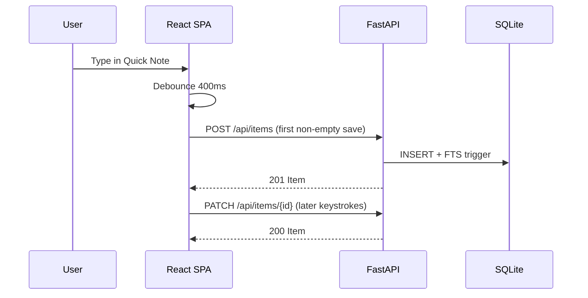
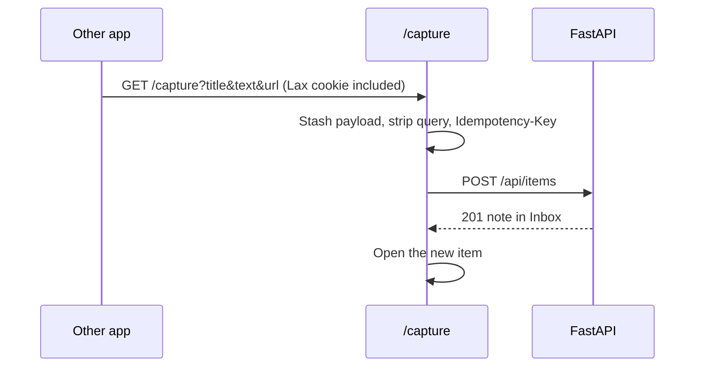

# Notes — Architecture and Implementation Plan

Personal, single-user productivity hub. Capture in under two seconds; organize later. Anything saved without a project lands in the Inbox.

This document is the build contract. No application code ships until the decisions in [§1](#1-decisions-to-approve) are approved.

**Target:** `https://notes.janrosell.com` — one Docker container, SQLite on a volume, reverse proxy in front.

**Stack (locked):** Python 3.12, FastAPI, Uvicorn, Pydantic v2, SQLite (WAL + FTS5), React 19, TypeScript, Vite, Tailwind CSS v4, `lucide-react`, `vite-plugin-pwa`.

---

## 1. Decisions to approve

These are settled in this plan. Change them here, before milestone 1.

| # | Decision | Why |
| --- | --- | --- |
| 1 | **One `items` table** with `type` of `note`, `task`, or `meeting` | Inbox, search, pin, and “convert to task” are one stream. Type-specific columns are guarded by `CHECK` constraints so a note cannot acquire a Kanban status. |
| 2 | **`aiosqlite` + SQL files**, Pydantic at the edges | FTS5, pragmas, and triggers are the product. A thin SQL layer keeps them visible. Repositories return Pydantic models. |
| 3 | **Due dates are calendar dates** (`due_on` = `YYYY-MM-DD`), not timestamps | “Today” and “Tomorrow” must not drift across midnight-UTC. The browser sends `today` as the device’s local date. `app_meta.timezone` (default `Europe/Madrid`) is the fallback for titles and exports. |
| 4 | **Four seeded contexts, rename and recolor only** | Matches the global filter (3 jobs + Personal). Ids and slugs stay stable when display names change. Adding a fifth context is a later migration, not a v1 feature. |
| 5 | **Tasks from Quick Add land in `todo`** | They show up in Today / No Due Date and in the project Todo column. `backlog` is only created from the board. |
| 6 | **Archive is soft (`archived_at`). Delete is hard.** | Archive hides an item from Inbox, Home, boards, and search. Delete removes the row. No trash view in v1. |
| 7 | **Auth cookie:** `HttpOnly`, `SameSite=Lax`, `Secure` in production, 30 days, JWT HS256 | PWA relaunches stay signed in. Logout clears the cookie. `session_version` in the token lets a future password change invalidate old cookies. |
| 8 | **Web Share Target uses GET `/capture`** | A share from WhatsApp or Chrome is a cross-site navigation. `SameSite=Lax` cookies are sent on that GET and are withheld on a cross-site POST. The page then creates the Inbox note with the normal authenticated API. iOS Safari does not implement `share_target`; iOS uses the in-app capture buttons. |
| 9 | **Service worker caches the app shell only** | `/api/*` is `NetworkOnly`. Offline opens the shell and shows an offline state. Notes are not served from a stale cache. |
| 10 | **Editor is one component, two hosts** | Home opens it as a focused overlay (note or transcript). Feeds and deep links open the same component at `/item/:id`. Quick Task stays a bar on Home so Enter can record many tasks without leaving the page. |
| 11 | **Mobile Kanban does not depend on drag** | Desktop uses `@dnd-kit`. Below 768px each card has a `Move to…` menu. Columns also scroll sideways with scroll-snap. |
| 12 | **AI, calendar, and Microsoft 365 are seams, not features** | Nullable columns, a settings card, a calendar placeholder, and `POST /api/items/{id}/ai-process` → `501`. |

---

## 2. Product rules that constrain the design

**Persona.** One human, three jobs, about six active projects, days full of meetings. The interface is dark, dense, and quiet. Color appears on context badges, priority marks, and status pills.

**Capture.** Creating a note, task, or transcript never requires a project, a context, or a tag. `project_id IS NULL` means Inbox. The global context filter never hides Inbox: an unassigned item has no context yet. With a context selected, Home and search still include unassigned items so a capture made in a hurry stays visible. Assigned items outside that context are hidden.

**Triage.** Inbox is chronological (newest first) and holds notes, tasks, and meetings together. Assigning a project removes the card from Inbox. Converting a note turns that same row into a task (`todo`) so `/item/:id` stays stable.

**Tasks.** A task has a status, a priority, an optional due date, and a board position. Checking a box sets `status = done` and `completed_at`. Unchecking returns it to `todo` and clears `completed_at`. Done tasks stay on the Done column and drop out of the List view groups.

**Meetings.** `body_md` is the editable “Takeaways & action items” document. `transcript_raw` is the pasted transcript, shown in a drawer that is collapsed by default. Search still indexes the raw transcript.

**Highlight to task.** Selecting text in a note or meeting creates a new `task` in the same project (or Inbox) with `source_item_id` pointing at the source. The source stays a note or meeting. That is a different action from Inbox “Convert to task”.

**Pins.** Notes and meetings can be pinned to Home. Tasks cannot.

**Single user.** No accounts table, no sharing, no roles. The only identity is the admin in the environment.

---

## 3. System shape

```text
Browser (installed PWA or desktop)
  │  same origin
  ▼
Reverse proxy  TLS, notes.janrosell.com → 127.0.0.1:8000
  │
  ▼
One container
  ├─ Uvicorn / FastAPI
  │    ├─ /api/*          JSON, cookie auth
  │    ├─ /capture        SPA fallback (share target)
  │    └─ /*              Vite build, SPA fallback
  └─ /data/notes.db       volume, WAL, FTS5
```

Dev runs two processes: Vite on port 5173 proxies `/api` to Uvicorn on port 8000. The browser still sees one origin, so cookie behavior matches production.





---

## 4. Repository layout

Every path below is created during the milestones named in [§9](#9-implementation-milestones). Root `README.md` is updated in milestone 5 with the runbook only.

```text
notes/
├── PLAN.md
├── README.md                          # runbook, written in M5
├── .env.example
├── .gitignore
├── .dockerignore
├── Dockerfile
├── docker-compose.yml
├── deploy/
│   └── Caddyfile.example              # host proxy, not inside the image
├── backend/
│   ├── pyproject.toml
│   ├── app/
│   │   ├── __init__.py
│   │   ├── main.py                    # app factory, static mount, security headers
│   │   ├── config.py                  # pydantic-settings
│   │   ├── db.py                      # connection, pragmas, migrations, write lock
│   │   ├── security.py                # argon2, JWT, cookie, origin check, login limiter
│   │   ├── deps.py                    # current user, db handle
│   │   ├── errors.py                  # error body + handlers
│   │   ├── schemas/
│   │   │   ├── auth.py
│   │   │   ├── context.py
│   │   │   ├── project.py
│   │   │   ├── item.py
│   │   │   ├── search.py
│   │   │   ├── home.py
│   │   │   ├── settings.py
│   │   │   ├── integration.py
│   │   │   └── ai.py
│   │   ├── routers/
│   │   │   ├── health.py
│   │   │   ├── auth.py
│   │   │   ├── contexts.py
│   │   │   ├── projects.py
│   │   │   ├── items.py
│   │   │   ├── search.py
│   │   │   ├── home.py
│   │   │   ├── settings.py
│   │   │   ├── backup.py
│   │   │   └── integrations.py
│   │   ├── services/
│   │   │   ├── contexts.py
│   │   │   ├── projects.py
│   │   │   ├── items.py
│   │   │   ├── search.py
│   │   │   ├── home.py
│   │   │   ├── backup.py
│   │   │   └── idempotency.py
│   │   └── migrations/
│   │       └── 001_init.sql
│   └── tests/
│       ├── conftest.py                # temp db, env, AsyncClient
│       ├── test_health.py
│       ├── test_auth.py
│       ├── test_contexts.py
│       ├── test_projects.py
│       ├── test_items.py
│       ├── test_search.py
│       ├── test_home.py
│       ├── test_backup.py
│       └── test_ai_stub.py
└── frontend/
    ├── package.json
    ├── tsconfig.json
    ├── tsconfig.app.json
    ├── tsconfig.node.json
    ├── vite.config.ts
    ├── index.html
    ├── public/
    │   ├── favicon.svg
    │   └── icons/
    │       ├── icon-192.png
    │       ├── icon-512.png
    │       └── maskable-512.png
    └── src/
        ├── main.tsx
        ├── vite-env.d.ts
        ├── styles/
        │   └── index.css              # Tailwind v4 + design tokens
        ├── app/
        │   ├── App.tsx
        │   ├── router.tsx
        │   └── providers.tsx          # QueryClient, router, toasts
        ├── lib/
        │   ├── api.ts                 # fetch wrapper, error type, idempotency
        │   ├── queryKeys.ts
        │   ├── dates.ts               # local today, group tasks
        │   ├── shortcuts.ts
        │   └── cn.ts
        ├── stores/
        │   └── ui.ts                  # context filter, sidebar, palette, toasts
        ├── types/
        │   └── api.ts                 # mirrors Pydantic response models
        ├── components/
        │   ├── shell/
        │   │   ├── AppShell.tsx
        │   │   ├── TopBar.tsx
        │   │   ├── Sidebar.tsx
        │   │   ├── BottomNav.tsx
        │   │   ├── ContextSwitcher.tsx
        │   │   └── CommandPalette.tsx
        │   ├── ui/
        │   │   ├── Button.tsx
        │   │   ├── IconButton.tsx
        │   │   ├── Modal.tsx
        │   │   ├── Popover.tsx
        │   │   ├── TextField.tsx
        │   │   ├── ContextBadge.tsx
        │   │   ├── PriorityMark.tsx
        │   │   ├── StatusPill.tsx
        │   │   ├── EmptyState.tsx
        │   │   ├── OfflineBanner.tsx
        │   │   ├── Toast.tsx
        │   │   └── Kbd.tsx
        │   ├── capture/
        │   │   ├── QuickNoteSheet.tsx
        │   │   ├── QuickTaskBar.tsx
        │   │   ├── TranscriptSheet.tsx
        │   │   └── ProjectDialog.tsx
        │   ├── items/
        │   │   ├── InboxCard.tsx
        │   │   ├── TaskRow.tsx
        │   │   └── PinnedCard.tsx
        │   ├── editor/
        │   │   ├── Editor.tsx
        │   │   ├── FormatToolbar.tsx
        │   │   ├── SlashMenu.tsx
        │   │   ├── MarkdownPreview.tsx
        │   │   ├── TranscriptDrawer.tsx
        │   │   ├── SelectionTaskButton.tsx
        │   │   └── ProjectPill.tsx
        │   └── kanban/
        │       ├── Board.tsx
        │       ├── Column.tsx
        │       ├── Card.tsx
        │       └── MoveToMenu.tsx
        └── routes/
            ├── LoginPage.tsx
            ├── HomePage.tsx
            ├── InboxPage.tsx
            ├── ProjectsPage.tsx
            ├── ProjectDetailPage.tsx
            ├── ItemPage.tsx
            ├── TasksPage.tsx
            ├── SettingsPage.tsx
            └── CapturePage.tsx
```

Libraries locked at implementation time via lockfiles:

| Area | Library |
| --- | --- |
| API | `fastapi`, `uvicorn[standard]`, `pydantic`, `pydantic-settings`, `aiosqlite` |
| Auth | `argon2-cffi`, `PyJWT` |
| Tests | `pytest`, `pytest-asyncio`, `httpx` |
| UI | `react`, `react-dom`, `react-router`, `@tanstack/react-query`, `lucide-react`, `tailwindcss` `@tailwindcss/vite` |
| Editor | `codemirror`, `@codemirror/lang-markdown`, `@codemirror/commands`, `@codemirror/view`, `@codemirror/state`, `react-markdown`, `remark-gfm` |
| Board | `@dnd-kit/core`, `@dnd-kit/sortable` |
| PWA / fonts | `vite-plugin-pwa`, `@fontsource-variable/inter`, `@fontsource/jetbrains-mono` |

No Redux, no form library, no component kit, no syntax-highlighting bundle. Fenced code renders in JetBrains Mono.

---

## 5. SQLite schema

**File:** `/data/notes.db`  
**Migration:** `backend/app/migrations/001_init.sql`, applied once inside a transaction.  
**Version row:** `app_meta.schema_version = 1`.

### 5.1 Connection pragmas

Set on the single long-lived connection at startup, and on any short-lived connection (backup):

```sql
PRAGMA journal_mode = WAL;
PRAGMA foreign_keys = ON;
PRAGMA synchronous = NORMAL;
PRAGMA busy_timeout = 5000;
PRAGMA temp_store = MEMORY;
PRAGMA cache_size = -20000;   -- 20 MB
```

`journal_mode` and `foreign_keys` are easy to get wrong: `foreign_keys` is per connection, and `journal_mode` must actually execute. Startup fails if `journal_mode` does not come back as `wal`, or if `foreign_keys` is not `1`.

**Access pattern.** One `aiosqlite` connection for the process. An `asyncio.Lock` wraps every statement. One user does not need concurrent writers, and a single connection is the reliable SQLite setup. Request handlers `await` the lock; they do not open a pool.

**Rowids and VACUUM.** `items.id` is a TEXT uuid. FTS5 external content is keyed by SQLite `rowid`. A full `VACUUM` can renumber rowids on tables without an `INTEGER PRIMARY KEY` and would desync the index. Normal operation never runs `VACUUM`. The downloadable backup uses the SQLite online backup API (rowids preserved). Any future maintenance vacuum calls `INSERT INTO fts_search(fts_search) VALUES('rebuild')` before serving traffic again. Milestone 2 tests this rebuild.

### 5.2 DDL

```sql
-- Timestamps are UTC text: 2026-11-15T10:48:00.000Z
-- due_on is a calendar date: 2026-11-15
-- ids are uuid4 strings

CREATE TABLE app_meta (
  key   TEXT PRIMARY KEY,
  value TEXT NOT NULL
);

CREATE TABLE contexts (
  id         TEXT PRIMARY KEY,
  slug       TEXT NOT NULL UNIQUE,
  name       TEXT NOT NULL,
  color      TEXT NOT NULL,
  sort_order INTEGER NOT NULL UNIQUE,
  created_at TEXT NOT NULL,
  updated_at TEXT NOT NULL,
  CHECK (length(trim(name)) > 0),
  CHECK (color GLOB '#[0-9A-Fa-f][0-9A-Fa-f][0-9A-Fa-f][0-9A-Fa-f][0-9A-Fa-f][0-9A-Fa-f]')
);

CREATE TABLE projects (
  id          TEXT PRIMARY KEY,
  context_id  TEXT NOT NULL REFERENCES contexts(id) ON UPDATE CASCADE ON DELETE RESTRICT,
  name        TEXT NOT NULL,
  color       TEXT,
  archived_at TEXT,
  created_at  TEXT NOT NULL,
  updated_at  TEXT NOT NULL,
  CHECK (length(trim(name)) BETWEEN 1 AND 200),
  CHECK (color IS NULL OR color GLOB '#[0-9A-Fa-f][0-9A-Fa-f][0-9A-Fa-f][0-9A-Fa-f][0-9A-Fa-f][0-9A-Fa-f]')
);

CREATE TABLE items (
  id                TEXT PRIMARY KEY,
  type              TEXT NOT NULL,
  title             TEXT NOT NULL DEFAULT '',
  body_md           TEXT NOT NULL DEFAULT '',
  project_id        TEXT REFERENCES projects(id) ON UPDATE CASCADE ON DELETE SET NULL,
  status            TEXT,
  priority          TEXT,
  due_on            TEXT,
  completed_at      TEXT,
  position          REAL,
  pinned            INTEGER NOT NULL DEFAULT 0,
  transcript_raw    TEXT,
  ai_summary        TEXT,
  ai_action_items   TEXT,
  calendar_event_id TEXT,
  calendar_provider TEXT,
  external_url      TEXT,
  source_item_id    TEXT REFERENCES items(id) ON UPDATE CASCADE ON DELETE SET NULL,
  source_selection  TEXT,
  archived_at       TEXT,
  created_at        TEXT NOT NULL,
  updated_at        TEXT NOT NULL,
  CHECK (type IN ('note', 'task', 'meeting')),
  CHECK (length(title) <= 500),
  CHECK (pinned IN (0, 1)),
  CHECK (status IS NULL OR status IN ('backlog', 'todo', 'in_progress', 'blocked', 'done')),
  CHECK (priority IS NULL OR priority IN ('none', 'low', 'medium', 'high', 'urgent')),
  CHECK (due_on IS NULL OR due_on GLOB '[0-9][0-9][0-9][0-9]-[0-9][0-9]-[0-9][0-9]'),
  CHECK (calendar_provider IS NULL OR calendar_provider IN ('google', 'microsoft')),
  CHECK (source_item_id IS NULL OR source_item_id <> id),
  CHECK (
    (type = 'task'
      AND status IS NOT NULL
      AND priority IS NOT NULL
      AND pinned = 0
      AND transcript_raw IS NULL)
    OR
    (type = 'note'
      AND status IS NULL
      AND priority IS NULL
      AND due_on IS NULL
      AND position IS NULL
      AND completed_at IS NULL
      AND transcript_raw IS NULL)
    OR
    (type = 'meeting'
      AND status IS NULL
      AND priority IS NULL
      AND due_on IS NULL
      AND position IS NULL
      AND completed_at IS NULL)
  )
);

CREATE TABLE idempotency_keys (
  key          TEXT PRIMARY KEY,
  item_id      TEXT NOT NULL REFERENCES items(id) ON DELETE CASCADE,
  request_hash TEXT NOT NULL,
  created_at   TEXT NOT NULL
);

CREATE INDEX idx_projects_context
  ON projects (context_id, archived_at, name);

CREATE INDEX idx_items_inbox
  ON items (created_at DESC)
  WHERE project_id IS NULL AND archived_at IS NULL;

CREATE INDEX idx_items_project_type
  ON items (project_id, type, updated_at DESC)
  WHERE archived_at IS NULL;

CREATE INDEX idx_items_tasks_due
  ON items (due_on, status)
  WHERE type = 'task' AND archived_at IS NULL;

CREATE INDEX idx_items_board
  ON items (project_id, status, position)
  WHERE type = 'task' AND archived_at IS NULL;

CREATE INDEX idx_items_pinned
  ON items (updated_at DESC)
  WHERE pinned = 1 AND archived_at IS NULL;

CREATE INDEX idx_items_source
  ON items (source_item_id)
  WHERE source_item_id IS NOT NULL;

CREATE VIRTUAL TABLE fts_search USING fts5(
  title,
  body_md,
  transcript_raw,
  content = 'items',
  content_rowid = 'rowid',
  tokenize = 'unicode61 remove_diacritics 2'
);
```

`unicode61 remove_diacritics 2` is the tokenizer because capture will mix English, Catalan, and Spanish. `reunio` matches `reunió`. Porter would stem English and damage the other two.

### 5.3 FTS triggers

External content: the text lives on `items`; FTS stores the index. `snippet()` reads back through the content table. Column names match real `items` columns (`title`, `body_md`, `transcript_raw`), which is what the spec asks to index. `ai_summary` is excluded until an LLM writes it.

```sql
CREATE TRIGGER items_fts_ai AFTER INSERT ON items BEGIN
  INSERT INTO fts_search (rowid, title, body_md, transcript_raw)
  VALUES (new.rowid, new.title, new.body_md, COALESCE(new.transcript_raw, ''));
END;

CREATE TRIGGER items_fts_ad AFTER DELETE ON items BEGIN
  INSERT INTO fts_search (fts_search, rowid, title, body_md, transcript_raw)
  VALUES ('delete', old.rowid, old.title, old.body_md, COALESCE(old.transcript_raw, ''));
END;

CREATE TRIGGER items_fts_au
AFTER UPDATE OF title, body_md, transcript_raw ON items BEGIN
  INSERT INTO fts_search (fts_search, rowid, title, body_md, transcript_raw)
  VALUES ('delete', old.rowid, old.title, old.body_md, COALESCE(old.transcript_raw, ''));
  INSERT INTO fts_search (rowid, title, body_md, transcript_raw)
  VALUES (new.rowid, new.title, new.body_md, COALESCE(new.transcript_raw, ''));
END;
```

Archived rows stay in the index. Search joins `items` and drops `archived_at IS NOT NULL`. Hard delete removes the index row in the same transaction as the `DELETE`.

Startup, after migrate:

```sql
INSERT INTO fts_search(fts_search) VALUES('rebuild');
```

Rebuild is cheap on a personal database and heals a trigger that failed during development.

### 5.4 Seed

Stable ids so a renamed context does not break the client’s stored filter.

| id | slug | name | color | sort |
| --- | --- | --- | --- | --- |
| `ctx_job1` | `job1` | Job 1 | `#3B82F6` | 1 |
| `ctx_job2` | `job2` | Job 2 | `#A855F7` | 2 |
| `ctx_job3` | `job3` | Job 3 | `#F59E0B` | 3 |
| `ctx_personal` | `personal` | Personal | `#10B981` | 4 |

```sql
INSERT INTO app_meta (key, value) VALUES
  ('schema_version', '1'),
  ('session_version', '1'),
  ('timezone', 'Europe/Madrid');
```

`timezone` is overwritten from `USER_TIMEZONE` when that env var is set and the row is still the default.

### 5.5 Column rules

| Column | Who sets it | Rule |
| --- | --- | --- |
| `title` | Client | Tasks require a non-empty trim. Notes default to `Untitled` on first save if the title is empty and the body is not. Meetings default to `Meeting - YYYY-MM-DD HH:mm` in the device zone, computed on the client and sent in the create body. |
| `body_md` | Client | Note body, task description, or meeting takeaways. |
| `project_id` | Client | `NULL` is Inbox. Deleting a project sets this to `NULL` (items return to Inbox). Context is never stored on the item; it always comes from the project. |
| `status` | Server default, client moves | Tasks only. Default `todo`. `done` writes `completed_at`. Leaving `done` clears `completed_at`. |
| `priority` | Client | Tasks only. Default `none`. |
| `due_on` | Client | Tasks only. `Today` / `Tomorrow` chips send a date. |
| `position` | Server | Tasks only. Fractional index within `(project_id, status)`. `NULL` project still orders among Inbox tasks of that status. New card: `COALESCE(MAX(position), 0) + 1024`. Move between neighbors: midpoint. If the gap is below `1e-6`, renumber that column as `1024, 2048, …` inside the same transaction. |
| `pinned` | Client | Notes and meetings. `1` or `0`. |
| `transcript_raw` | Client | Meetings only. Empty string is stored as `NULL`. |
| `ai_summary`, `ai_action_items` | Future LLM | Always `NULL` in v1. The stub endpoint does not write them. |
| `calendar_event_id`, `calendar_provider`, `external_url` | Share target writes `external_url` | Calendar columns stay `NULL`. A shared link is stored on `external_url` and appended to `body_md`. |
| `source_item_id`, `source_selection` | Extract-task | New task only. Selection is the highlighted substring, capped at 2 000 characters. |
| `archived_at` | Archive action | Set to UTC now. Unarchive clears it. |

Size caps, enforced in Pydantic before SQL: `title` 500, `body_md` 500 000, `transcript_raw` 2 000 000 characters. Over the cap → `413`.

### 5.6 Why one table

Inbox, command-palette search, pin, and backup are all “an item”. Convert-to-task is an `UPDATE` of `type` plus task defaults on the same primary key. Extract-to-task is an `INSERT` of a child task. FTS triggers attach once.

The `CHECK` on `type` keeps the table honest: a note has no status, due date, or position; a task has no transcript and cannot be pinned; a meeting has no Kanban fields and may hold `transcript_raw`. Application code repeats those rules and returns `422` with a field error before SQLite does.

A task created from a highlight does not need a join table. One nullable self-FK is enough at this scale. The task card shows “From {source title}”.

---

## 6. HTTP API

Base path `/api`. JSON. Cookie auth on every route except `GET /api/health`, `POST /api/auth/login`.

### 6.1 Conventions

**Error body** (FastAPI handler, every 4xx/5xx):

```json
{ "detail": "Project not found", "code": "not_found" }
```

Validation errors use `code: "validation_error"` and `detail` as a list of `{ "loc": ["body", "title"], "msg": "..." }`.

| Status | When |
| --- | --- |
| 400 | Malformed FTS query, bad cursor, bad `Idempotency-Key` |
| 401 | Missing or invalid session |
| 413 | Body over the caps in §5.5 |
| 404 | Unknown id, or archived project on create |
| 409 | Idempotency key reused with a different payload hash (see below) |
| 422 | Pydantic or type-rule violation |
| 429 | Login rate limit |
| 501 | AI stub |

**Auth dependency.** `get_current_user` reads cookie `notes_session`, verifies HS256, requires `sub == ADMIN_USERNAME` and `sv == app_meta.session_version`. Failure is `401` with `code: "unauthenticated"`. The handler does not distinguish expired vs tampered.

**CSRF.** State-changing requests whose `Origin` header is present and not in `ALLOWED_ORIGINS` are rejected with `403` / `code: "bad_origin"`. Browser mutations send `Origin`. Same-origin deployments (this app) send the site origin. `SameSite=Lax` covers the rest. No CSRF token.

**Partial updates.** `PATCH` bodies use `model_dump(exclude_unset=True)`. Omitted fields stay. JSON `null` clears nullable fields (`project_id`, `due_on`, `external_url`). This distinction is tested.

**Ids.** Client never chooses the id. Server generates `uuid4`.

**Idempotency.** Optional header `Idempotency-Key` (1–80 chars, `[A-Za-z0-9_-]`). The first request stores the key, the new `item_id`, and a SHA-256 of the canonical JSON body in `idempotency_keys.request_hash`. The same key and the same hash return that item with `200`. The same key with a different hash returns `409`. Keys older than 24 hours are deleted on the next insert. The share-target page always sends a key.

**Timestamps in JSON** match the database text. The client formats them.

**Context filter query param.** `context_id` omitted means all contexts. Unknown id → `404`.

**Cursor.** Opaque base64url of `created_at + "\\n" + id` (Inbox and general lists) or `updated_at + "\\n" + id` when that is the sort. Invalid cursor → `400`.

### 6.2 Health

`GET /api/health` → `200`

```json
{ "status": "ok" }
```

No auth. Docker `HEALTHCHECK` hits this.

### 6.3 Auth

`POST /api/auth/login` → `200` or `401` or `429`  
Auth: none.

```json
// request
{ "username": "jan", "password": "..." }

// response
{ "username": "jan" }
```

Sets `Set-Cookie: notes_session=<jwt>; HttpOnly; Secure; SameSite=Lax; Path=/; Max-Age=2592000`.

`Secure` is omitted when `COOKIE_SECURE=false` (local http only). Production `.env` has `COOKIE_SECURE=true`.

JWT claims: `sub` (username), `sv` (int), `iat`, `exp` (`iat + 30 days`). Algorithm pinned to HS256. Startup refuses a `SESSION_SECRET` shorter than 32 bytes.

Password check is argon2id (`memory_cost=65536`, `time_cost=3`, `parallelism=4`) against `ADMIN_PASSWORD_HASH`. If the hash is empty and `ADMIN_PASSWORD` is set, the process hashes the plaintext into memory at startup and logs a single warning telling the operator to switch to a hash. The plaintext is not logged and is not written back to disk. Unknown user and bad password return the same `401` / `"Invalid username or password"`.

Rate limit: 5 failures per 15 minutes per client IP, then `429`. The bucket resets on success. IP is `X-Forwarded-For`’s first hop only when `TRUST_PROXY=true`; otherwise the socket peer.

`POST /api/auth/logout` → `204`  
Clears the cookie (`Max-Age=0`). Auth required so a random caller cannot probe the route’s existence differently; unauthenticated logout also returns `204` and clears the cookie, to make the client simple. No server session store.

`GET /api/auth/me` → `200` `{ "username": "jan" }` or `401`.

There is no password-change route in v1. `session_version` exists so adding one later does not change the cookie format. The settings screen does not pretend it can rotate the password.

### 6.4 Contexts

`GET /api/contexts` → `200`

```json
{
  "contexts": [
    {
      "id": "ctx_job1",
      "slug": "job1",
      "name": "Job 1",
      "color": "#3B82F6",
      "sort_order": 1,
      "created_at": "2026-11-15T09:00:00.000Z",
      "updated_at": "2026-11-15T09:00:00.000Z"
    }
  ]
}
```

`PATCH /api/contexts/{context_id}` → `200` `Context`  
Body, all optional: `name` (1–80), `color` (`#RRGGBB`), `sort_order` (integer, unique). Duplicate `sort_order` → `422`. No create, no delete.

### 6.5 Projects

`Project` response:

```json
{
  "id": "…",
  "name": "Atlas",
  "color": "#3B82F6",
  "context": {
    "id": "ctx_job1",
    "slug": "job1",
    "name": "Job 1",
    "color": "#3B82F6"
  },
  "archived_at": null,
  "created_at": "…",
  "updated_at": "…"
}
```

`color` in the response is the display color: the project’s own color, or the context color when the project color is null. The raw nullable value is included as `color_override`.

`GET /api/projects?context_id=&include_archived=false` → `200` `{ "projects": [Project, …] }`  
Sorted by `context.sort_order`, then `name` case-insensitive.

`POST /api/projects` → `201` `Project`

```json
{ "name": "Atlas", "context_id": "ctx_job1", "color": "#3B82F6" }
```

`color` optional. Unknown or missing `context_id` → `422` / `404` respectively (`404` if the id format is valid but absent).

`GET /api/projects/{project_id}` → `200` or `404`.

`PATCH /api/projects/{project_id}` → `200`  
Optional `name`, `context_id`, `color` (`null` clears the override).

`POST /api/projects/{project_id}/archive` → `200` `Project`  
`POST /api/projects/{project_id}/unarchive` → `200` `Project`

`DELETE /api/projects/{project_id}` → `204`  
Hard-deletes the project. Items survive with `project_id` set to `NULL` and therefore reappear in Inbox. Client confirms first.

### 6.6 Items

`Item` response:

```json
{
  "id": "…",
  "type": "task",
  "title": "Send the revised diagram",
  "body_md": "",
  "project": null,
  "status": "todo",
  "priority": "high",
  "due_on": "2026-11-15",
  "completed_at": null,
  "position": 1024.0,
  "pinned": false,
  "transcript_raw": null,
  "ai_summary": null,
  "ai_action_items": null,
  "calendar_event_id": null,
  "calendar_provider": null,
  "external_url": null,
  "source_item_id": null,
  "source_selection": null,
  "archived_at": null,
  "created_at": "…",
  "updated_at": "…"
}
```

`project` is `null` (Inbox) or:

```json
{
  "id": "…",
  "name": "Atlas",
  "color": "#3B82F6",
  "context": { "id": "ctx_job1", "slug": "job1", "name": "Job 1", "color": "#3B82F6" }
}
```

`GET /api/items` → `200`

```json
{ "items": [Item], "next_cursor": null }
```

| Query | Meaning |
| --- | --- |
| `type` | `note`, `task`, or `meeting` |
| `project_id` | A project uuid, or the literal `none` for Inbox |
| `context_id` | Items in that context’s projects, plus unassigned items |
| `pinned` | `true` / `false` |
| `status` | Task status |
| `due` | `overdue`, `today`, `upcoming`, `none`. Requires `today=YYYY-MM-DD` except `none` |
| `today` | Device-local date used by `due` |
| `include_done` | Default `false` for lists. Kanban client passes `true` or simply omits `due` and requests `type=task` |
| `archived` | Default `false`. `true` returns only archived |
| `limit` | Default 50, max 200 |
| `cursor` | From the previous page |

Sort: Inbox (`project_id=none`) by `created_at DESC`. Pinned by `updated_at DESC`. Tasks with a `due` filter by `due_on ASC, created_at ASC`. Otherwise `updated_at DESC`.

`POST /api/items` → `201` `Item` (or `200` on idempotent replay)

```json
{
  "type": "note",
  "title": "",
  "body_md": "Ship the schema review",
  "project_id": null,
  "status": null,
  "priority": null,
  "due_on": null,
  "pinned": false,
  "transcript_raw": null,
  "external_url": null
}
```

Server fills defaults per §5.5. First-save rule is client-side (do not POST an empty note). The server still accepts an empty note so autosave can create a shell if the client chooses; Home does not. A task without `status` becomes `todo`. A task without `priority` becomes `none`. Position is assigned. A `note` or `meeting` that includes task fields → `422`.

`GET /api/items/{item_id}` → `200` or `404`  
Archived items are returned by direct id so an open editor does not 404 after archive. Lists hide them.

`PATCH /api/items/{item_id}` → `200` `Item`  
Any mutable field except `type`, `id`, `position` (use move), `completed_at` (derived), `ai_*`, `calendar_*`, `source_*`. Sending `type` → `422` (use the convert endpoint). Moving a task to `done` via `status` is allowed and sets `completed_at`.

`DELETE /api/items/{item_id}` → `204` or `404`  
Hard delete. FTS trigger runs. Idempotency rows cascade.

`POST /api/items/{item_id}/archive` → `200` `Item`  
`POST /api/items/{item_id}/unarchive` → `200` `Item`

`POST /api/items/{item_id}/convert-to-task` → `200` `Item`  
Source must be `type=note` and not archived, else `409` with `code: "not_a_note"`. Sets `type=task`, `status=todo`, `priority=none`, assigns `position`, keeps `title`, `body_md`, `project_id`, `pinned` forced to false. If `title` is empty, title becomes the first non-empty line of `body_md`, truncated to 120 characters, or `Untitled`.

`POST /api/items/{item_id}/extract-task` → `201` `Item`

```json
{ "title": "Send the revised diagram", "selection": "send the revised diagram" }
```

Source must be a non-archived `note` or `meeting`, else `409`. New task copies `project_id`, `status=todo`, `priority=none`, `source_item_id`, `source_selection`. Title required.

`POST /api/items/{item_id}/move` → `200` `Item`  
Tasks only, else `409`.

```json
{
  "status": "in_progress",
  "before_id": null,
  "after_id": "…"
}
```

`before_id` is the card that should end up immediately above this one after the drop; `after_id` immediately below. Either may be null (move to start or end). Both set: position is the midpoint. Neighbors must share the destination `status` and the same `project_id` (both null, or both the same id), else `422`. Server recomputes `position` and, when entering or leaving `done`, maintains `completed_at`.

`POST /api/items/{item_id}/ai-process` → `501`

```json
{
  "detail": "AI processing is not configured",
  "code": "ai_not_configured",
  "item_id": "…",
  "planned_effects": {
    "writes": ["ai_summary", "ai_action_items"],
    "may_create": "tasks with source_item_id"
  }
}
```

The route is registered and tested. It does not read an API key and does not modify the item. The button in the editor is `disabled` and points its click handler at the client function that calls this route, so enabling it later is a one-line change plus an implementation behind the same path.

### 6.7 Home, search, settings, backup, integrations

`GET /api/home?context_id=&today=YYYY-MM-DD` → `200`

`today` is required (`422` if missing or not a date).

```json
{
  "today": "2026-11-15",
  "inbox_count": 4,
  "pinned": [Item],
  "today_tasks": [Item]
}
```

- `inbox_count`: all unarchived items with `project_id IS NULL`. Ignores `context_id`.
- `pinned`: unarchived pinned notes and meetings, `updated_at DESC`, limit 24. With `context_id`, keep pins whose project is in that context, plus pins that have no project.
- `today_tasks`: unarchived tasks, `due_on = today`, `status != done`, ordered by priority (`urgent`, `high`, `medium`, `low`, `none`) then `position`. Same context rule: matching project context, plus unassigned.

`GET /api/search?q=&context_id=&limit=` → `200`

`limit` default 20, max 50. `q` required.

```json
{
  "results": [
    {
      "id": "…",
      "type": "meeting",
      "title": "Meeting - 2026-11-15 09:30",
      "snippet": "…action item: send the diagram…",
      "snippet_field": "transcript_raw",
      "project": null,
      "updated_at": "…"
    }
  ]
}
```

Query builder (server):

1. Trim, reject empty → `400`.
2. Split on whitespace. Drop tokens under 2 characters. If none remain → `400`.
3. Strip FTS punctuation (`" * : ( ) ^`).
4. Build `'"token1"* AND "token2"*'`.
5. `MATCH` against `fts_search`, join `items` on `rowid`, left join `projects` and `contexts`.
6. Filter `archived_at IS NULL`. Apply the same context rule as Home.
7. `ORDER BY bm25(fts_search) LIMIT :limit`. In FTS5, a smaller `bm25` is a better match.

Snippet: request `snippet()` for columns 1 (`body_md`) and 2 (`transcript_raw`) with markers `«` and `»`, ellipsis `…`, 18 tokens. Prefer the body snippet when it contains a marker; otherwise the transcript snippet. Titles match even when the snippet comes from the body. Column 0 is the title and is returned whole as `title`, not as the snippet.

Command-palette actions (New note, New task, Paste transcript, Switch context) are client-side. They are not part of this payload.

`GET /api/settings` → `200` `{ "timezone": "Europe/Madrid", "schema_version": 1 }`

`PATCH /api/settings` → `200` the same shape. Body `{ "timezone": "Europe/Madrid" }`. Validated with `zoneinfo`. Unknown zone → `422`. Used for meeting-title fallback and as the displayed zone in Settings. Task grouping uses the `today` the client sends.

`GET /api/integrations` → `200`

```json
{
  "ai": { "configured": false, "provider": null },
  "google_calendar": { "configured": false },
  "microsoft_calendar": { "configured": false }
}
```

`configured` is true only when the corresponding env var is non-empty (`AI_API_KEY`, `GOOGLE_CALENDAR_CLIENT_ID`, `MS_GRAPH_CLIENT_ID`). The secret is never returned. v1 does not read these to do work; the settings cards show “Not connected”.

`GET /api/backup/json` → `200` `application/json` attachment `notes-YYYYMMDD.json`

```json
{
  "exported_at": "…",
  "schema_version": 1,
  "timezone": "Europe/Madrid",
  "contexts": [],
  "projects": [],
  "items": []
}
```

Items include `transcript_raw`. Projects include `color_override` and `context_id`, not the nested display object. `idempotency_keys` are omitted.

`GET /api/backup/sqlite` → `200` `application/vnd.sqlite3` attachment `notes-YYYYMMDD.db`  
Uses the online backup API into a temp file, then streams it. Consistent under WAL. Auth required. `Cache-Control: no-store`.

### 6.8 Screen → endpoint map

| Screen | Reads | Writes |
| --- | --- | --- |
| Login | — | `POST /api/auth/login` |
| Shell | `GET /api/auth/me`, `GET /api/contexts`, `GET /api/home` (count) | `POST /api/auth/logout` |
| Home | `GET /api/home` | `POST /api/items`, `PATCH /api/items/{id}`, `POST /api/projects` |
| Inbox | `GET /api/items?project_id=none` | `PATCH` project, `POST …/convert-to-task`, `POST …/archive`, `DELETE` |
| Projects | `GET /api/projects` | `POST /api/projects` |
| Project | `GET /api/projects/{id}`, `GET /api/items?project_id=` | item create, `POST …/move`, archive |
| Editor | `GET /api/items/{id}` | `PATCH`, `POST …/extract-task`, pin via `PATCH` |
| Tasks | `GET /api/items?type=task&today=` | `PATCH` status, `POST …/move` |
| Command palette | `GET /api/search` | navigates; create actions call `POST /api/items` or open overlays |
| Capture | query string | `POST /api/items` |
| Settings | contexts, settings, integrations | `PATCH` context, `PATCH` settings, backup GETs |

---

## 7. Frontend

### 7.1 Routes

`react-router` in declarative mode (the route table lives in `router.tsx`).

| Path | Auth | Chrome | Purpose |
| --- | --- | --- | --- |
| `/login` | public | none | Username + password |
| `/` | yes | shell | Home |
| `/inbox` | yes | shell | Triage |
| `/projects` | yes | shell | Projects by context |
| `/projects/:projectId` | yes | shell | Notes / Board / Meetings |
| `/item/:itemId` | yes | editor bar, no bottom nav | Full editor |
| `/tasks` | yes | shell | List or Kanban |
| `/settings` | yes | shell | Contexts, backup, integration cards |
| `/capture` | yes | shell | Share-target landing |
| anything else | yes | shell | Redirect to `/` |

Unauthenticated visits to a private route redirect to `/login?next=<path>`. After login, `next` is honored only if it is a relative path starting with `/` and not `//`.

Project sub-tabs are `?tab=notes|board|meetings`, default `notes`. Task view is `?view=list|board`, default `list`. Both are reflected in the URL so refresh and back behave.

The editor route is lazy-loaded. Home preloads that chunk on idle so Quick Note does not pay the CodeMirror cost on the first tap.

### 7.2 State

**Server state — TanStack Query.**  
Query keys:

```text
['me']
['contexts']
['settings']
['integrations']
['home', contextId, today]
['items', filters]
['item', id]
['project', id]
['projects', contextId]
['search', q, contextId]
```

Invalidation after a write is specific: a task toggle updates `['home']`, `['items']`, and `['item', id]`. It does not wipe the whole cache.

**Optimistic updates.**

| Action | Cache behavior |
| --- | --- |
| Check / uncheck task | Patch `status` and `completed_at` in every list that contains the id. Roll back the snapshots on error. Toast the error. |
| Quick task Enter | Insert a temporary item (`id` starts with `tmp_`) at the top of the matching group. Replace with the server item. Remove on error. |
| Inbox assign / convert / archive / delete | Remove the card immediately. Restore on error. |
| Kanban move | Move the card in the cached column list, then `POST /move`. Restore the previous columns on error. |
| Note autosave | No optimistic row. The overlay holds local state. Status text is `Saving…` / `Saved` / `Offline — not saved`. |

**UI state — Zustand store `ui.ts`, persisted in `localStorage`.**

| Key | Values |
| --- | --- |
| `notes.contextId` | `all` or a context id |
| `notes.sidebarCollapsed` | boolean |
| `notes.tasksView` | `list` or `board` |
| `notes.editorPreview` | `edit` or `preview` |
| `notes.calendarSlotOpen` | boolean |

Command palette open flag and toast queue stay in memory.

**Autosave.** 400ms after the last keystroke in a note or transcript. The timer resets on each change. Flush also runs on `visibilitychange` hidden and on overlay close. First flush of a new capture `POST`s; later flushes `PATCH` `title` and `body_md` (and `transcript_raw` for meetings). A save that fails keeps the dirty flag and retries on the next edit or when `online` fires.

**Search debounce.** 150ms, `AbortController` on the previous request.

### 7.3 Design tokens

Dark only. Tailwind v4, tokens in `frontend/src/styles/index.css`. No `prefers-color-scheme` branch.

```css
@import "tailwindcss";
@import "@fontsource-variable/inter";
@import "@fontsource/jetbrains-mono";

@theme {
  --font-sans: "Inter Variable", ui-sans-serif, system-ui, sans-serif;
  --font-mono: "JetBrains Mono", ui-monospace, monospace;

  --color-canvas: #09090b;
  --color-elevated: #111113;
  --color-interactive: #18181b;
  --color-border: #27272a;
  --color-border-subtle: #1f1f23;
  --color-border-strong: #3f3f46;
  --color-fg: #fafafa;
  --color-fg-secondary: #a1a1aa;
  --color-fg-muted: #71717a;

  --color-priority-urgent: #ef4444;
  --color-priority-high: #f97316;
  --color-priority-medium: #eab308;
  --color-priority-low: #71717a;
  --color-status-progress: #3b82f6;
  --color-status-blocked: #ef4444;
  --color-status-done: #22c55e;
}
```

Context colors are data (`contexts.color`), not tokens. They render as a 6px dot and as text. Badge background is `color-mix(in srgb, var(--ctx) 16%, transparent)` with a 1px border at 40% of the same color. Large surfaces stay neutral.

| Element | Treatment |
| --- | --- |
| Page | `bg-canvas text-fg font-sans` |
| Sidebar, cards, modals, bottom nav | `bg-elevated border border-border` |
| Hover / pressed row | `bg-interactive` |
| Hairline inside a card | `border-border-subtle` |
| Primary button | `bg-fg text-canvas` |
| Secondary button | `bg-interactive text-fg border border-border-strong` |
| Ghost button | transparent, hover `bg-interactive` |
| Input | `bg-canvas border-border` focus ring `border-fg` (1px, no glow) |
| Metadata, timestamps, kbd | `font-mono text-fg-muted` |
| Radius | 10px cards, 8px controls, 999px pills |
| Focus | 1px `fg` outline, 2px offset, visible on keyboard only |

Typography scale: 13px metadata, 14px UI, 16px editor body, 20px page title. Editor line-height 1.6. No display serif, no gradient, no shadow stack. A modal may use a single `0 16px 48px rgb(0 0 0 / 0.45)` so it separates from the canvas; nothing else gets a shadow.

Motion: 120ms opacity/transform on overlays. `@media (prefers-reduced-motion: reduce)` disables it.

Touch: interactive targets `min-h-11 min-w-11` (44px). Bottom nav adds `padding-bottom: env(safe-area-inset-bottom)`. Page shell uses `min-h-dvh`.

Viewport meta:

```html
<meta name="viewport" content="width=device-width, initial-scale=1, viewport-fit=cover, interactive-widget=resizes-content" />
<meta name="theme-color" content="#09090B" />
<meta name="apple-mobile-web-app-capable" content="yes" />
```

`interactive-widget=resizes-content` keeps the Quick Task chips above the keyboard. Pinch-zoom stays available.

Priority mark: a single colored dot plus the word on the task row (`Urgent`, `High`, `Medium`, `Low`). `none` shows nothing.

Status pill: mono label, 1px border, muted text. `in_progress`, `blocked`, and `done` use the status colors for the text and border only.

### 7.4 Shell

**Top bar (all breakpoints).** Height 48px. Left: wordmark `Notes`. Center or next: context pill button that opens the switcher (`All contexts`, then the four contexts with their dots). Right: search button (label `Search` on desktop, icon on mobile) showing `⌘K` in mono, and an account menu with Settings and Log out.

The active context id is sent on Home, Projects, Project list filtering, Tasks, and Search. Switching context does not navigate away.

**Desktop (`min-width: 768px`).** Sidebar 240px, collapsible to 56px (icons only). Collapse control at the bottom of the sidebar. Nav items: Home, Inbox (count), Projects, Tasks. Under them, up to eight project shortcuts for the active context (name + dot), from `GET /api/projects`. A project click goes to `/projects/:id`.

**Mobile (`max-width: 767px`).** No sidebar. Fixed bottom bar, four tabs, same destinations, icon above a 11px label. The bar is `bg-elevated` with a top `border-border`. Inbox shows the count as a small mono numeral. Editor and login hide the bar.

**Keyboard (ignored when the target is an input, textarea, or contenteditable).**

| Shortcut | Action |
| --- | --- |
| `Mod+K` | Open command palette |
| `C` | Open Quick Note |
| `T` | Open Quick Task |
| `Esc` | Close the topmost overlay |

`Mod` is `Meta` on macOS and `Ctrl` elsewhere. The shortcut hint component (`Kbd`) shows the right one.

### 7.5 Screens

**Login.** Centered card, max width 360px, on `canvas`. Title `Notes`, fields Username and Password, primary button `Continue`. Submit on Enter. `401` shows “Invalid username or password” under the form. `429` shows “Too many attempts. Wait a few minutes.” No other copy.

**Home.** Two regions.

Top, “Capture”: a 2-column grid on mobile, 4-column on desktop.

- `+ Quick Note` — primary, spans one column, min height 88px. Opens `QuickNoteSheet`.
- `+ Quick Task` — primary, same size. Opens `QuickTaskBar` and focuses the input.
- `+ Paste transcript` — secondary, full width under the two primaries. Opens `TranscriptSheet`.
- `+ New project` — ghost, small, aligned to the end of the capture header. Opens `ProjectDialog`.

`QuickNoteSheet` is a full-screen sheet on mobile and a 720px centered sheet on desktop. Title input, then the editor, autofocused. Footer: `Saved` status, and a project pill defaulting to `Inbox`. Closing an untouched sheet does not create a row.

`QuickTaskBar` docks above the bottom nav (mobile) or as a centered bar (desktop). One text input. Placeholder `Add a task`. Chip row, in order: `Today`, `Tomorrow`, `@ Project`, `! Priority`. Today and Tomorrow toggle `due_on` and show as selected (`bg-interactive border-border-strong`). `@ Project` opens a popover of projects plus Inbox. `! Priority` opens a popover of Urgent / High / Medium / Low / None. Enter `POST`s, clears the title, leaves the chips as they are so a run of similar tasks stays fast, and keeps focus in the input. The bar stays open until Esc or the close button.

`TranscriptSheet` mirrors the note sheet. Title is prefilled with `Meeting - YYYY-MM-DD HH:mm` using the device clock, and the whole title is selected so a paste-over is one keystroke. Project pill. One large textarea labeled `Transcript`, min height 40vh. Primary `Save to Inbox` (or `Save to {project}`). Save creates `type=meeting` and navigates to `/item/:id`.

`ProjectDialog`: Name, Context (select, default = active context, or Personal when the filter is All), Color (six swatches: the four context colors plus zinc `#A1A1AA` and the default “use context color”). Create closes and navigates to the new project.

Bottom, “Focus”:

1. **Pinned** — horizontal scroll on mobile, 3-column grid from 768px up. Card: title, project or `Inbox`, relative time. Click opens `/item/:id`. Empty: the section is omitted, not a placeholder illustration.
2. **Today** — checkbox rows. Title, priority mark, project badge. Check calls the optimistic toggle. Empty copy: `Nothing due today`.
3. **Up next** — collapsible card, title `Up next`, subtitle `Calendar sync ready`. Body is one sentence: calendar sync will list the next meetings here. No button that implies it works. Open state persists. Collapsed by default after the first visit if the user closes it.

**Inbox.** Page title `Inbox`, mono count. Stack of cards, newest first. Each card: type label (`Note`, `Task`, `Meeting`), title, two-line preview of `body_md` or transcript, time. Actions, each a 44px button: `Assign`, `Convert` (notes only), `Archive`, `Delete`.

`Assign` opens a popover listing projects. Choosing one `PATCH`es `project_id` and removes the card. `Convert` turns the note into a task in place. The card stays, because it is still unassigned, and its type label changes to `Task`. Archive and Delete ask for a second tap on the same control (`Archive?` / `Delete?`) so triage stays one-handed. Delete’s second tap uses the blocked-status color for the label only.

**Projects.** Groups are the contexts, in `sort_order`, skipping contexts excluded by the filter. A context with no active projects still shows, with a ghost `New project` that opens the dialog pre-filled with that context. Each project row is a color dot and a name, and links to `/projects/:id`. v1 rows do not show item counts; the list payload has no counts, and a per-project fetch would multiply requests on the way in.

**Project detail.** Header: dot, name, context badge, overflow menu (`Rename`, `Archive`, `Delete`). Tabs: `Notes`, `Board`, `Meetings`.

- Notes: list of note cards plus `+ Note in project`, which opens the note sheet with `project_id` set.
- Board: five columns `Backlog`, `Todo`, `In Progress`, `Blocked`, `Done`. Each column has `+ Add card`, an inline input, Enter creates a task in that status and project. Desktop: drag with `@dnd-kit`, keyboard sensor included (space to pick up, arrows, space to drop). Mobile: horizontal snap scroll, and `Move to…` on every card listing the five statuses. Drag sensors are not registered below 768px.
- Meetings: newest first, title and date. `+ Paste transcript` opens the transcript sheet with this `project_id`.

**Editor (`/item/:id` and the capture sheets).**

Header: back, title field, `Pin` (notes and meetings), project pill, preview toggle (`Edit` / `Preview`), and a disabled button `AI summarize` with a sparkle icon from lucide (`Sparkles`). Disabled reason, via `aria-describedby`: `AI processing is not configured`. The client module `lib/api.ts` exports `aiProcess(id)` calling the stub. The button’s `onClick` is that function; `disabled` prevents the call.

Body: CodeMirror 6, `lineWrapping`, markdown language, content height filling the sheet. No line numbers.

Formatting toolbar, sticky above the keyboard on mobile and at the top of the editor on desktop: `H1`, `H2`, `Bold`, `List`, `Checkbox`, `Code`. Each wraps or prefixes the selection using CodeMirror transactions. Checkbox inserts `- [ ] `.

Desktop slash menu: when the user types `/` at the start of a line, a small list offers the same six commands. Choosing one replaces the slash. This is part of milestone 4, not a stretch goal; the set is exactly those six.

Preview: `react-markdown` + `remark-gfm`. Raw HTML is not enabled. Links only render for `http:` and `https:`.

Highlight to task: on `mouseup` / selection change, if the selection is non-empty and inside the editor, show a floating button `Create task` just above the selection. Activate creates via `extract-task` and toasts `Task created` with a link to the new item. On touch devices the browser selection UI is unreliable, so the toolbar includes `Task` which runs the same action on the current selection, or no-ops with a toast `Select text first`.

Transcript mode, when `type === meeting`: the takeaways editor is `body_md`, labeled `Takeaways and action items`. Below it, a disclosure `Raw transcript`, collapsed by default, showing character count. Expanded: a find input (`Ctrl/Cmd+F` inside the drawer, not the browser find) that filters to matching lines and highlights the query with a `<mark>` using the existing fg colors (background `interactive`, text `fg`). The drawer does not load a second editor; it is a `<pre>` of `transcript_raw` so a 10 000-word paste stays cheap. Editing the raw transcript is a separate `Edit raw` toggle that swaps the `<pre>` for a textarea and autosaves `transcript_raw`.

**Tasks.**

Segmented control: `List`, `Board`.

List groups, computed on the client from one `GET /api/items?type=task&include_done=false&limit=200&today=`:

| Group | Rule |
| --- | --- |
| Overdue | `due_on < today` |
| Today | `due_on === today` |
| Upcoming | `due_on > today` |
| No due date | `due_on` null |

Inside a group: priority order, then title. Checkbox, title, due label, project badge. A row click opens a small editor for title, due, priority, and project — not the full markdown page. The row’s body, if any, is edited there too. This keeps task triage fast. A “Open” link goes to `/item/:id` for the rare long description.

Board: same five columns as a project board, cards from every project allowed by the context filter, plus unassigned. Column headers show counts. Drag and `Move to…` behave as on the project board. `+ Add card` creates an Inbox task in that status (no project). The user assigns a project from the card.

**Command palette.** Centered modal, 560px, input autofocused. With an empty query, show actions: New note, New task, Paste transcript, and one row per context (`Switch to {name}`). With a query, debounce into `GET /api/search` and list results under the actions that still match the text. Result row: type, title, snippet, project name. Enter on a result navigates to `/item/:id` (tasks included). Arrow keys move the active row. `Esc` closes.

**Settings.**

1. Contexts. Each row: color swatch (native color input, writing `#RRGGBB`), name field, save on blur via `PATCH`. Slug shown in mono, read-only.
2. Timezone. A text field defaulting to the settings value, save on blur.
3. Backup. Two buttons: `Download database`, `Download JSON`. They hit the backup routes and save the blob. Failures toast.
4. Integrations. Three static cards from `GET /api/integrations`: `AI provider`, `Google Calendar`, `Microsoft 365`. Each shows `Not connected`. No connect button.

**Capture page.** On mount, read `title`, `text`, and `url`. If all three are empty and nothing is pending in `sessionStorage`, redirect to `/inbox`. Otherwise build a note:

- title: share title, or the URL host, or `Shared note`
- `external_url`: the url param or null
- `body_md`: text, then a blank line, then the url if it is not already in the text
- `project_id`: null

Write `{ key, payload }` to `sessionStorage` under `notes.pendingShare`, replace the address bar with `/capture` (query removed), `POST /api/items` with `Idempotency-Key: key`. On success, clear the stash and `replace` to `/item/:id`. On failure, stay on the page with the text visible and a `Retry` button. Login redirect: if `GET /api/auth/me` is 401, stash first, go to `/login?next=/capture`, and let the page finish the POST after login.

### 7.6 PWA

`vite-plugin-pwa` with `registerType: 'autoUpdate'`.

Manifest (produced by the plugin, values fixed):

```json
{
  "name": "Notes",
  "short_name": "Notes",
  "description": "Personal notes, tasks, and meetings",
  "start_url": "/",
  "scope": "/",
  "display": "standalone",
  "orientation": "portrait",
  "background_color": "#09090B",
  "theme_color": "#09090B",
  "icons": [
    { "src": "/icons/icon-192.png", "sizes": "192x192", "type": "image/png" },
    { "src": "/icons/icon-512.png", "sizes": "512x512", "type": "image/png" },
    { "src": "/icons/maskable-512.png", "sizes": "512x512", "type": "image/png", "purpose": "maskable" }
  ],
  "share_target": {
    "action": "/capture",
    "method": "GET",
    "params": { "title": "title", "text": "text", "url": "url" }
  }
}
```

Workbox:

| Request | Strategy |
| --- | --- |
| Precache | `index.html`, built JS/CSS, fonts, icons, manifest |
| Navigations | `NetworkFirst`, fallback to the precached shell |
| `/api/*` | `NetworkOnly` |

`index.html` and the service worker are served `Cache-Control: no-cache`. Hashed assets are `immutable`.

`OfflineBanner` listens to `online` / `offline` and renders a one-line bar under the top bar: `Offline. Captures will not save until you reconnect.`

Share target limits: GET keeps the session cookie, and it tops out near the length a proxy will accept. The capture page refuses a query longer than 32 KB with a plain message telling the user to paste inside the app. That covers links and typical shared snippets. File shares and multi-megabyte transcripts are a paste, not a share. iOS: the manifest entry is harmless and ignored; the installed PWA is still the mobile client.

Icons are simple: word `N` in `fg` on `canvas`, exported at the three sizes during milestone 5. No illustration.

### 7.7 FastAPI static hosting

The image copies `frontend/dist` to `/app/static`.

- `GET /api/*` is never rewritten.
- A path that matches a file in `/app/static` is that file.
- Any other `GET` returns `/app/static/index.html`.
- `sw.js`, `registerSW.js`, `manifest.webmanifest`, and `index.html` use `Cache-Control: no-cache`.
- Files under `/assets/` use `Cache-Control: public, max-age=31536000, immutable`.

Security headers on every response:

```text
X-Content-Type-Options: nosniff
Referrer-Policy: no-referrer
X-Frame-Options: DENY
Content-Security-Policy: default-src 'self'; img-src 'self' data:; style-src 'self' 'unsafe-inline'; script-src 'self'; manifest-src 'self'; connect-src 'self'
```

`style-src 'unsafe-inline'` is there because Tailwind v4 and CodeMirror emit inline style attributes. Scripts stay `'self'`. No third-party origins.

---

## 8. Deployment and configuration

### 8.1 Environment

`.env.example`:

```bash
ADMIN_USERNAME=jan
ADMIN_PASSWORD_HASH=
ADMIN_PASSWORD=

SESSION_SECRET=
COOKIE_SECURE=true
ALLOWED_ORIGINS=https://notes.janrosell.com
TRUST_PROXY=true
USER_TIMEZONE=Europe/Madrid
DATA_DIR=/data

# Read only by GET /api/integrations. Unused by any worker in v1.
AI_API_KEY=
GOOGLE_CALENDAR_CLIENT_ID=
MS_GRAPH_CLIENT_ID=
```

Startup fails when `SESSION_SECRET` is short, when `ADMIN_USERNAME` is empty, or when both password variables are empty. `ALLOWED_ORIGINS` is a comma-separated list.

A helper documented in the README, not a long-running service:

```text
python -m app.security hash-password
```

Prints an argon2id hash to stdout. The operator pastes it into `ADMIN_PASSWORD_HASH` and leaves `ADMIN_PASSWORD` empty.

### 8.2 Image and compose

Multi-stage Dockerfile:

1. `node:22-alpine` — `npm ci`, `npm run build`, output `frontend/dist`.
2. `python:3.12-slim` — install the backend from `pyproject.toml`, copy `dist` to `/app/static`, run as uid 1000, `WORKDIR /app`.

```text
CMD ["uvicorn", "app.main:app", "--host", "0.0.0.0", "--port", "8000",
     "--proxy-headers", "--forwarded-allow-ips", "*"]
```

`--forwarded-allow-ips *` is acceptable because compose publishes `127.0.0.1:8000:8000` only. The process is not reachable except through the host proxy.

```yaml
services:
  notes:
    build: .
    restart: unless-stopped
    env_file: .env
    ports:
      - "127.0.0.1:8000:8000"
    volumes:
      - notes-data:/data
    healthcheck:
      test: ["CMD", "python", "-c", "import urllib.request; urllib.request.urlopen('http://127.0.0.1:8000/api/health')"]
      interval: 30s
      timeout: 5s
      retries: 3

volumes:
  notes-data:
```

`DATA_DIR=/data`. The file is `/data/notes.db`. The directory is created on startup if missing, owned by uid 1000.

Caddy on the host (`deploy/Caddyfile.example`):

```caddy
notes.janrosell.com {
  reverse_proxy 127.0.0.1:8000
}
```

Caddy terminates TLS and sets `X-Forwarded-Proto`. The app uses that, with `TRUST_PROXY=true`, when deciding the client IP for the login limiter. The cookie `Secure` flag is controlled by `COOKIE_SECURE`, not by sniffing the request, so a misconfigured proxy cannot silently downgrade it.

### 8.3 Logging

Uvicorn access log plus one JSON line per application error: `request_id`, method, path, status. Bodies, cookies, and the `Authorization` header are never logged. Transcripts are never logged.

### 8.4 What v1 deliberately leaves out

- Accounts, sharing, public links
- Offline write queue and sync
- Tags, reminders, recurrence, subtask trees, comments, file attachments
- A trash view (archive and hard delete only)
- Light theme
- Syntax highlighting inside fenced code
- Real LLM calls, OAuth, calendar fetch
- iOS share-sheet integration beyond “open the installed app and paste”
- `VACUUM` in the request path

---

## 9. Implementation milestones

Each milestone ends in a review before the next starts. Tests cited here are the acceptance gate, not an optional extra.

### Milestone 1 — Infra, database, auth

**Build**

- Backend tree, `pyproject.toml`, settings, error shape, health route.
- `db.py`: pragmas, migration runner, seed, write lock, startup assertions for WAL and foreign keys.
- `001_init.sql` exactly as §5, including FTS triggers and the four contexts.
- Auth: hash, login, logout, me, cookie flags, rate limit, origin check, `session_version` claim.
- `tests/conftest.py` against a temp file database.

**Acceptance**

- [ ] Fresh process creates `/data/notes.db` (or the temp path), `journal_mode=wal`, `foreign_keys=1`.
- [ ] Four contexts exist with the seed ids.
- [ ] Inserting a note creates an FTS row; the trigger test inserts and selects `rowid` from `fts_search`.
- [ ] A task row with `status IS NULL` fails the CHECK. A note row with `status='todo'` fails the CHECK.
- [ ] `POST /api/auth/login` sets a cookie with `HttpOnly` and `SameSite=Lax`. With `COOKIE_SECURE=true` the cookie is `Secure`.
- [ ] Wrong password and wrong username return the same 401 body.
- [ ] Sixth failure inside the window returns 429.
- [ ] `GET /api/auth/me` is 401 without the cookie and 200 with it.
- [ ] A JWT signed with a different `sv` than `app_meta.session_version` is 401.
- [ ] `POST` with a foreign `Origin` is 403.
- [ ] `GET /api/health` is 200 without a cookie.
- [ ] Startup exits if `SESSION_SECRET` is shorter than 32 bytes.

### Milestone 2 — CRUD, search, backup

**Build**

- All routes in §6 except the static SPA.
- Services for items (convert, extract, move, position repair), search query builder, backup.
- Pytest coverage for the rules below.

**Acceptance**

- [ ] Create note without `project_id`, then `GET /api/items?project_id=none` returns it.
- [ ] `PATCH` with `project_id` set removes it from that Inbox query. `PATCH` with `project_id: null` puts it back. Omitting `project_id` does not change it.
- [ ] Convert note → task keeps the id, sets `todo` / `none`, and a second convert returns 409.
- [ ] Extract-task creates a task with `source_item_id`, same `project_id`, and does not change the source type.
- [ ] Move between two neighbors sets a position strictly between them. Move to `done` sets `completed_at`. Move back to `todo` clears it.
- [ ] Deleting a project nulls `project_id` on its items; the items are still fetchable.
- [ ] Archive hides the item from Inbox, Home, and search, and `GET /api/items/{id}` still returns it.
- [ ] Hard delete removes the item from search results.
- [ ] Search finds a token that exists only in `transcript_raw`, and a diacritic-insensitive match (`reunio` vs `reunió`).
- [ ] Search rejects a one-character query with 400 and does not error on a quote or asterisk in the user string.
- [ ] Home with `context_id=ctx_job1` returns that context’s today-tasks plus unassigned today-tasks, and omits another context’s tasks. `inbox_count` includes everything unassigned.
- [ ] `POST /api/items/{id}/ai-process` returns 501 and does not change `updated_at`.
- [ ] JSON backup round-trips contexts, projects, and a meeting with a long `transcript_raw`.
- [ ] SQLite backup file opens, passes `PRAGMA integrity_check`, and contains the same item ids.
- [ ] After `INSERT INTO fts_search(fts_search) VALUES('rebuild')`, search results are unchanged.
- [ ] Replay of the same `Idempotency-Key` and body returns the original item and does not insert a second row.

### Milestone 3 — Shell, Home, Inbox, palette

**Build**

- Vite, Tailwind tokens, router, query client, API client, login, shell, Home, Inbox, command palette, context switcher.
- Design tokens applied. No second theme.

**Acceptance**

- [ ] Unauthenticated `/` ends on `/login`, and a successful login lands on `/`.
- [ ] Session survives a reload (cookie). Logout returns to `/login` and `/api/auth/me` is 401.
- [ ] At 390px width the bottom nav shows four tabs, each target at least 44px tall, and the sidebar is absent.
- [ ] At 1100px the sidebar shows the four destinations and project shortcuts, and the bottom nav is absent.
- [ ] Colors on screen are the neutral scale plus context dots and priority dots. No light-theme toggle exists.
- [ ] Quick Note is focused and usable without choosing a project. The first save appears in Inbox. A second keystroke updates the same id (network panel shows POST then PATCH).
- [ ] Quick Task: Enter creates a task, clears the field, leaves focus in the input, and a `Today` chip makes the task appear under Today without a reload.
- [ ] Checking a Today checkbox updates the UI before the response returns. Forcing the request to fail restores the checkbox.
- [ ] Inbox assign, convert, archive, and delete each work with the controls in §7.5 and do not require a full reload.
- [ ] `Mod+K` opens the palette. A query returns an FTS hit and Enter opens it. `C` opens Quick Note when focus is not in a field.
- [ ] Context switch hides another job’s pinned notes and still shows unassigned pins and the Inbox count.
- [ ] The calendar card renders, collapses, and does not call an API.

### Milestone 4 — Projects, Kanban, editor, tasks, settings

**Build**

- Projects list and detail, board, editor, transcript drawer, extract-task, master tasks, settings.

**Acceptance**

- [ ] New project requires a name and a context, then shows under that context. Renaming a context in Settings changes the badge everywhere after refetch, including the top-bar switcher.
- [ ] Project board renders five columns. `+ Add card` creates a task in that column and that project.
- [ ] Desktop drag moves a card and a reload shows the new column and order.
- [ ] At 390px, `Move to…` moves a card, and drag is not required to reach every status.
- [ ] Editor autosaves a reload-proof body. Pin puts the note on Home. Project pill moves it between Inbox and a project.
- [ ] Selecting text and activating `Create task` creates a linked task in the same project. The source note is unchanged. The new task shows the source title.
- [ ] A meeting opens on the takeaways. The raw transcript is collapsed. A word that exists only in the transcript is findable in the drawer and via `Mod+K`.
- [ ] The AI button is visible, disabled, and does not fire a request. `curl` of the stub still returns 501.
- [ ] Tasks list groups Overdue, Today, Upcoming, and No due date using the machine’s local date. The board view shows the same tasks across projects and respects the context filter.
- [ ] Settings download of JSON and of the sqlite file both produce non-empty files the milestone 2 checks would accept.
- [ ] Slash menu on desktop and the six toolbar buttons on a narrow viewport each modify the markdown the preview renders (heading, bold, list, checkbox, code).

### Milestone 5 — PWA, Docker, verification

**Build**

- `vite-plugin-pwa` manifest and workbox rules, icons, capture page, Dockerfile, compose, Caddy example, README runbook.
- Production static hosting and security headers.

**Acceptance**

- [ ] `docker compose up --build` serves the SPA and `/api/health` on `127.0.0.1:8000`.
- [ ] The database file is on the named volume at `/data/notes.db` and survives a container recreate.
- [ ] Lighthouse (or the browser Application panel) shows an installable manifest: `display: standalone`, theme `#09090B`, and a `share_target` of GET `/capture`.
- [ ] With the network blocked, a reload still paints the shell and the offline bar. It does not paint cached notes.
- [ ] Opening `/capture?text=hello&url=https://example.com` while signed in creates one Inbox note, stores the URL on `external_url`, and a second load with the same idempotency key does not duplicate it.
- [ ] Response headers on `/` include `X-Frame-Options: DENY`, `nosniff`, and a CSP whose `script-src` is `'self'`.
- [ ] Cookie set by login against the deployed origin is `Secure`, `HttpOnly`, `SameSite=Lax`.
- [ ] README states: env vars, `hash-password`, compose, Caddy, backup download, and the iOS share limitation.
- [ ] The full pytest suite passes in the image’s Python environment. The frontend production build completes with no type errors.

### Suggested build order inside a milestone

Schema and tests before UI. Within milestone 3, login and shell before capture. Within milestone 4, the editor before the board, because extract-task depends on it. Do not start milestone 5 until milestone 4’s board works with a mouse and with `Move to…`.

---

## 10. Review checklist

Approve, or mark the row to change.

- [ ] Unified `items` table and the CHECK split between note, task, and meeting
- [ ] `aiosqlite`, SQL migrations, and Pydantic at the API boundary
- [ ] Date-only due dates and client-supplied `today`
- [ ] Four fixed contexts
- [ ] Quick-add tasks default to `todo`
- [ ] GET share target, app-shell-only service worker
- [ ] Archive vs hard delete
- [ ] Five milestones and their gates
